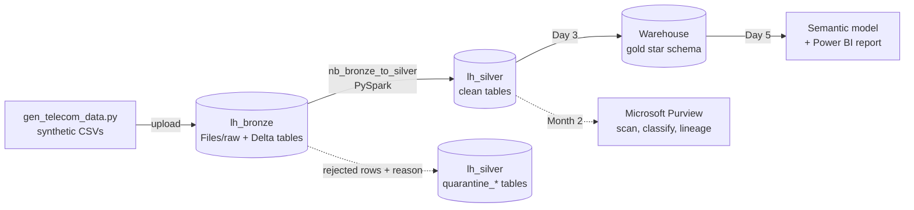

# Fabric Telecom Governance Lab

A hands-on Microsoft Fabric project where I build a telecom analytics platform **with data governance designed in from day one**, not added at the end.

The data is fully synthetic (fake subscribers, call records and service requests). Nothing in this repo comes from any employer or real customer.

**Author:** Hafsah Asif · Islamabad, Pakistan
**Background:** Teradata EDW operations and data governance, now learning Microsoft Fabric and Purview

---

## Why this project

Most Fabric tutorials stop at "load data, build a report". In real telecom and fintech environments, the harder questions are:

- Can we trust this data? Who checked it, and how?
- Where are the CNICs and phone numbers, and who can see them?
- If a record is rejected, where does it go and why?
- If a source changes, what breaks downstream?

This lab answers those questions step by step, on a medallion (bronze → silver → gold) architecture.

---

## Architecture



| Layer | What it holds | Governance controls |
|---|---|---|
| Bronze | Raw CSVs as uploaded, loaded to Delta as-is | Kept unchanged for audit and replay |
| Silver | Typed, deduplicated, validated data | DQ rules applied, failures quarantined with a reason and timestamp |
| Gold | Star schema for reporting | Business definitions, RLS, sensitivity labels (planned) |

---

## Dataset

Generated by [`data_generator/gen_telecom_data.py`](data_generator/gen_telecom_data.py) (Python standard library only).

| Table | Rows (default) | Contains |
|---|---|---|
| subscribers | ~5,050 | Name, CNIC, MSISDN, email, DOB (all fake PII) |
| cdrs | ~125,000 | Voice / SMS / data events, charges in PKR |
| service_requests | 3,000 | Category, priority, channel, resolution hours |
| plans | 7 | Prepaid, postpaid, broadband plans |
| regions | 10 | Pakistani cities and regions |

Fake values are deliberately recognisable: CNICs start with `99`, MSISDNs with `0399`, emails use `example.com/org/net`.

About 2% of rows are **intentionally dirty** (duplicates, missing CNIC, bad email, missing city, negative charges) so the data quality controls have something real to catch.

```bash
python data_generator/gen_telecom_data.py --out telecom_data
# options: --subscribers 5000 --cdrs-per-sub 20 --srs 3000 --dirty-rate 0.02 --seed 42
```

---

## Data quality rules

Full catalogue: [`docs/data_quality_rules.md`](docs/data_quality_rules.md). Each rule maps to a DAMA-DMBOK data quality dimension.

### Bronze scorecard (Day 1, actual result in Fabric)

| Check | Failures | DQ dimension |
|---|---|---|
| Duplicate subscribers | 50 | Uniqueness |
| Missing CNIC | 97 | Completeness |
| Invalid email | 110 | Validity |
| Missing city | 106 | Completeness |
| Negative charges | 2,478 | Validity |

### Silver (Day 2)

Bad rows are **not deleted**. They go to `quarantine_*` tables with a `dq_reason` and `quarantined_at`, so they can be audited and fixed at source.

| Table | Bronze | Silver | Quarantined |
|---|---|---|---|
| subscribers | 5,050 | 4,799 | 201 |
| cdrs | 124,687 | 117,318 | 7,369 |
| service_requests | 3,000 | 2,874 | 126 |

(50 subscriber duplicates are removed before validation, which is why 4,799 + 201 = 5,000.)

---

## Repo structure

```
data_generator/   synthetic data generator
notebooks/        Fabric notebook source (PySpark)
sql/bronze/       queries run on lh_bronze SQL analytics endpoint
sql/silver/       queries run on lh_silver SQL analytics endpoint
docs/             DQ rule catalogue, progress log, screenshots
```

---

## Progress

See [`docs/progress_log.md`](docs/progress_log.md).

- [x] Day 1: Workspace, bronze lakehouse, Delta tables, SQL endpoint, DQ scorecard
- [x] Day 2: PySpark notebook, silver layer, quarantine pattern
- [x] Day 3: Warehouse gold layer, star schema
- [ ] Day 4: Data pipeline and Dataflow Gen2
- [ ] Day 5: Semantic model and Power BI report
- [ ] Day 6: Workspace roles and item permissions
- [ ] Day 7: Row, column and object-level security
- [ ] Day 8: Sensitivity labels, endorsement, lineage and impact analysis
- [ ] Day 9: OneLake security, admin portal, capacity metrics
- [ ] Day 10: Git integration and deployment pipelines
- [ ] Month 2: Microsoft Purview scan, classification, glossary, data quality

---

## License

MIT. See [LICENSE](LICENSE).
