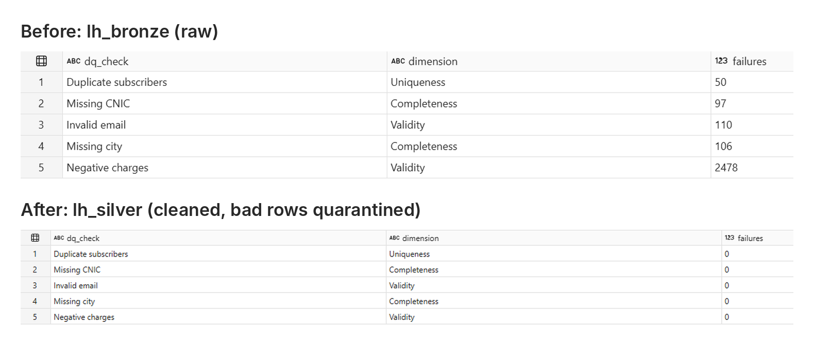

# Progress Log

## Day 1 - Bronze layer

**Built**
- Fabric trial workspace `ws-telecom-dev`
- Lakehouse `lh_bronze`, uploaded 5 CSVs to `Files/raw`
- Loaded each file to a Delta table (Load to Tables)
- Queried through the SQL analytics endpoint

**Results**
- Row counts reconciled with the generator output (5050 / 124687 / 3000 / 7 / 10)
- Bronze DQ scorecard: 50 duplicates, 97 missing CNIC, 110 invalid emails, 106 missing cities, 2,478 negative charges
- MTTR by priority: P1 4.5h, P2 14.1h, P3 42.4h, P4 97.4h

**Learned**
- Lakehouse vs SQL analytics endpoint (read-only T-SQL over the same Delta files)
- Files area vs Tables area in OneLake
- Workspace licence modes: Pro vs Fabric Trial capacity
- "MTTR" needs a written business definition before it can be trusted (closed only? business hours?)

## Day 2 - Silver layer

**Built**
- Lakehouse `lh_silver`
- Notebook `nb_bronze_to_silver` (PySpark) reading from `lh_bronze`, writing to `lh_silver`
- Quarantine tables for subscribers, CDRs and service requests

**Results**
- Confirmed in Fabric: subscribers 4,799 clean / 201 quarantined; cdrs 117,318 / 7,369; service_requests 2,874 / 126
- 
- Silver DQ scorecard: all 5 checks = 0
- 4,891 CDRs quarantined only because their subscriber was quarantined (integrity cascade)

**Learned**
- Explicit type casting instead of trusting inferred types (phone numbers lose their leading zero if stored as numbers)
- Quarantine pattern with reason codes
- Referential integrity checks across tables in Spark

## Day 3 - Gold layer (Warehouse, star schema)

**Built**
- Warehouse `wh_gold`, with `lh_silver` added for cross-database queries (`lh_silver.dbo.<table>`)
- Dimensions: `dim_date`, `dim_plan`, `dim_location`, `dim_subscriber`
- Facts: `fact_usage` (subscriber x day x event type), `fact_service_request` (one row per SR)
- Built with CTAS in T-SQL: `sql/gold/01_gold_star_schema.sql`

**Results**
- dim_date 694, dim_plan 7, dim_location 11, dim_subscriber 4,799, fact_usage 110,063, fact_service_request 2,874
- Reconciliation vs silver: subscribers 4,799 = 4,799; usage events 117,318 = 117,318; SRs 2,874 = 2,874; 0 orphan dates, plans or locations

**Learned**
- Fabric Warehouse does not support NVARCHAR. DATENAME() returns NVARCHAR, so it needs a CAST to VARCHAR
- Cross-database queries let a warehouse read lakehouse tables without copying files first
- Data minimisation in practice: CNIC, email and DOB are not carried into gold. DOB becomes an age band
- The calendar must start at the earliest date in any table, not just one (caught by the orphan-date check)

## Day 4 - Pipeline and audit log

**Built**
- Stored procedures in `wh_gold`: `dbo.usp_build_gold` (gold build) and `dbo.usp_check_gold` (reconciliation, fails with THROW if any check fails)
- Audit table `dbo.etl_run_log`: every check, every run, with timestamp, values and PASS/FAIL
- Pipeline `pl_bronze_to_gold`: Run silver notebook -> Build gold -> Check gold (on success)
- Script: `sql/gold/04_gold_procedures.sql`

**Results**
- First pipeline run succeeded end to end: notebook 3m 31s, build gold 13s, check gold 13s
- All 6 reconciliation checks PASS and logged

**Learned**
- A pipeline should not just move data, it should prove the data is right before anyone uses it
- A failing check should stop the pipeline loudly (THROW), not log quietly and carry on
- Fabric warehouse and Spark both run on UTC, so audit timestamps are 5 hours behind PKT
- Not scheduling it on purpose: a trial capacity should not burn compute on a timer

## Day 5 - Semantic model and report

**Built**
- Semantic model `sm_telecom_gold` (Direct Lake on SQL) on `wh_gold`, 7 tables, 8 relationships
- 6 measures, each with a format and a written description: `semantic_model/measures.dax`
- Report `rpt_telecom_overview`: 6 KPI cards, revenue by region and plan type, MTTR by priority, plan type slicer

**Results**
- All data: revenue PKR 5M, 4,799 active subscribers, ARPU PKR 944, churn 13.0%, MTTR 48.4h, DQ pass 100%
- Prepaid only: revenue PKR 2M, ARPU PKR 838
- MTTR by priority: P1 ~4.5h, P2 ~14h, P3 ~42h, P4 ~97h

**Learned**
- The semantic model is where "one definition per metric" lives. The description field is the business glossary
- Direct Lake does not validate relationships against data. It guessed one cardinality backwards
  because the fact table had fewer rows than its dimension. The Day 3 orphan-key checks are what make the joins trustworthy
- Facts link to dimensions only. Dimension-to-dimension links create ambiguous paths
- The "Unknown" region bar is a visible trace of a Day 2 DQ decision (default, don't reject)

## Day 6 - Access control

**Built**
- Reviewed workspace roles (Admin, Member, Contributor, Viewer). No one added to the practice workspace
- SQL roles in `wh_gold`: `rl_report_viewer`, `rl_pii_reader`, `rl_dq_steward` (`sql/security/01_sql_roles.sql`)
- Column-level security: `rl_report_viewer` gets 9 of 11 `dim_subscriber` columns, no `full_name` or `msisdn`
- Permission audit query (`sql/security/02_permission_report.sql`) and access model with personas and RACI (`docs/access_model.md`)

**Results**
- Permission report: 17 grants across 3 roles, no PII columns for the report viewer

**Learned**
- Every workspace role, even Viewer, gets SELECT on all warehouse tables. To hide PII, share the item, not the workspace
- Grant to roles, not people. Roles make access reviews possible
- The data owner is accountable for PII access; IT only carries it out

## Day 7 - Row-level security and masking

**Built**
- RLS: access table `dbo.sec_region_access`, predicate `sec.fn_region_filter`, policy `sec.region_policy` on both facts and `dim_subscriber` (`sql/security/03_row_level_security.sql`)
- Dynamic data masking on `msisdn` and `full_name` (`sql/security/04_dynamic_data_masking.sql`)
- `docs/data_protection.md`: minimisation, CLS, RLS and masking side by side

**Results**
- Mapped to North: 22,528 of 110,063 usage rows visible
- Reconciliation under RLS: 3 FAIL (985 vs 4,799 subscribers, 23,990 vs 117,318 events, 608 vs 2,874 SRs)
- Mapped to ALL: 6 PASS
- `sys.masked_columns` shows both masks

**Learned**
- RLS applies to workspace Admins too
- The pipeline / DQ identity must be mapped to ALL, or RLS makes quality checks fail
- Admin, Member and Contributor have UNMASK, so masking only protects Viewers and item-level users
- Masking is not encryption. It complements CLS and RLS

## Day 8 - Lineage, impact analysis, endorsement, classification

**Built**
- Workspace description and contact set
- `sm_telecom_gold` endorsed as **Promoted**, with a description; "Make discoverable" turned off for a practice model
- Deleted a stray empty notebook that was showing up as a false dependency in impact analysis
- `docs/data_classification.md`: item and column classification, since sensitivity labels are not enabled in the tenant

**Results**
- Lineage: lh_bronze/lh_silver -> nb_bronze_to_silver -> pl_bronze_to_gold <- wh_gold -> sm_telecom_gold -> rpt_telecom_overview
- Impact of wh_gold: semantic model, pipeline, report (1 viewer, 2 views)
- Certified and Master data endorsement greyed out: need a tenant admin to approve certifiers
- Sensitivity labels: turned off at tenant level

**Learned**
- Fabric lineage tracks item connections, not reads inside code. lh_silver -> wh_gold is missing because
  the gold build reads silver in SQL. Purview or a written lineage doc has to fill that gap
- "Child items" shows direct dependents only; "All downstream items" shows the full blast radius
- Clutter (empty items) creates false dependencies and makes impact analysis less trustworthy
- Endorsement tells users which copy is official; certification is a governed process, not a button
- Without labels, classification must be documented, but a document does not follow the data when it is exported
